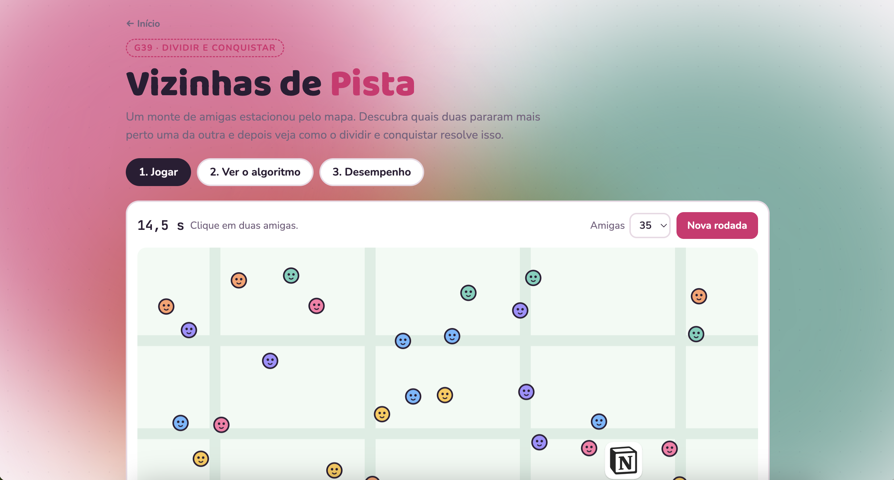
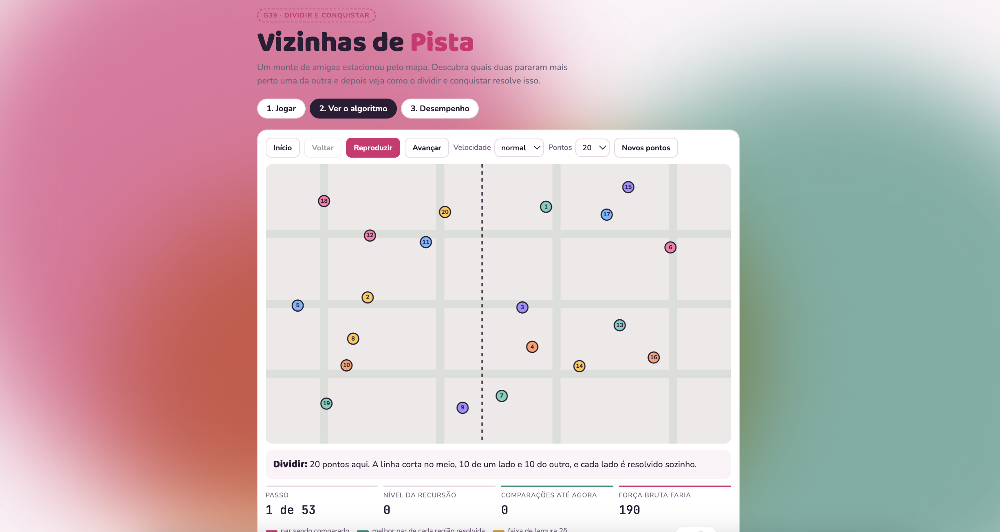
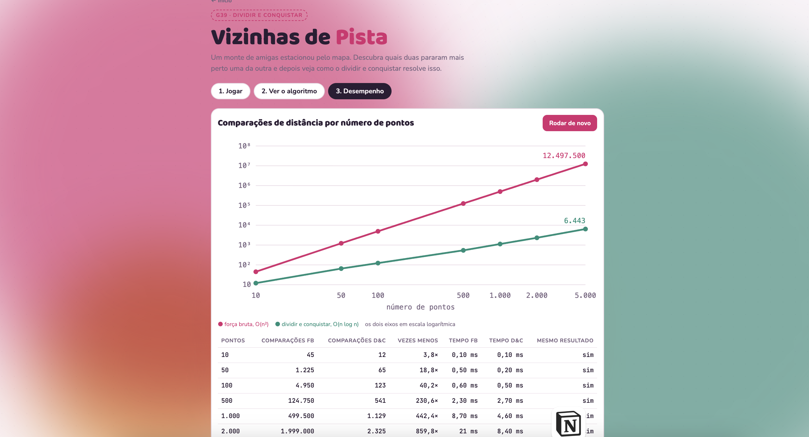

# Vizinhas de Pista

**Grupo:** G39<br>
**Conteúdo da disciplina:** Dividir e Conquistar


## Alunos

| Matrícula | Aluno |
| :---: | :--- |
| 231026680 | Cibelly Lourenço |
| 211039500 | Isabelle da Costa |

## Sobre

Um monte de amigas estacionou espalhado pelo mapa, e o jogador tem que descobrir quais duas pararam mais perto uma da outra. Parece fácil, mas com 35 ou 60 no mapa o olho engana bastante.

Por trás disso está o problema do **par de pontos mais próximos**, que resolvemos com dividir e conquistar.

O site tem três abas:

- **Jogar:** você escolhe o par e depois vê se acertou, comparando com a resposta do algoritmo.
- **Ver o algoritmo:** mostra a recursão acontecendo no mapa, passo a passo.
- **Desempenho:** compara a força bruta com o dividir e conquistar para até 5.000 pontos.

| Jogar | Ver o algoritmo | Desempenho |
| --- | --- | --- |
|  |  |  |

## Como rodar

Não precisa instalar nada.

1. Clone o repositório:

   ```bash
   git clone https://github.com/projeto-de-algoritmos-2026/G39_DividirEConquistar_PA-26.2.git
   cd G39_DividirEConquistar_PA-26.2
   ```

2. Abra o `index.html` no navegador: dois cliques no arquivo, ou `xdg-open index.html` no Linux (`open index.html` no Mac).

Os testes do algoritmo ficam no `testes.html`, que abre do mesmo jeito.

## O algoritmo

A forma mais simples de achar o par mais próximo é comparar todo mundo com todo mundo. Isso dá `n(n-1)/2` comparações, ou seja, O(n²). Com 5.000 pontos são 12,5 milhões de comparações.

Com dividir e conquistar dá para fazer em **O(n log n)**:

1. Ordena os pontos por x e por y, uma vez só, antes de começar.
2. **Dividir:** traça uma linha vertical no meio, deixando metade dos pontos de cada lado.
3. **Conquistar:** resolve cada lado sozinho, do mesmo jeito. Quando sobram 3 pontos ou menos, compara direto.
4. **Combinar:** pega a menor distância dos dois lados (`δ`). Um par melhor só pode existir se tiver um ponto de cada lado e os dois estiverem a menos de `δ` da linha. Então olhamos só os pontos dessa faixa, em ordem de y.

Cada nível da recursão faz O(n) de trabalho, então a recorrência é a mesma do mergesort: `T(n) = 2T(n/2) + O(n)`, que dá O(n log n).

O que deixa a combinação rápida é que cada ponto da faixa só precisa ser comparado com **no máximo 7 vizinhos**. Acima de um ponto, quem pode estar a menos de `δ` dele cabe num retângulo de `2δ` por `δ`. Se dividir esse retângulo em 8 quadradinhos de lado `δ/2`, cada um tem no máximo um ponto, porque dois pontos no mesmo quadradinho estariam do mesmo lado e a menos de `δ`, o que não pode. Sobram no máximo 7 além dele.

Um cuidado: a ordenação por y é feita só no começo. Se cada chamada ordenasse a faixa de novo, o algoritmo ficaria O(n log² n).

## Desempenho

Números de uma execução da aba "Desempenho" (o tempo muda de máquina para máquina):

| Pontos | Força bruta | Dividir e conquistar | Tempo FB | Tempo D&C |
| ---: | ---: | ---: | ---: | ---: |
| 100 | 4.950 | 141 | 1,7 ms | 0,4 ms |
| 1.000 | 499.500 | 1.157 | 1,6 ms | 2,9 ms |
| 5.000 | 12.497.500 | 6.365 | 42 ms | 8 ms |

Com poucos pontos a força bruta às vezes ganha no tempo, porque o dividir e conquistar perde tempo ordenando e montando as listas. Mas a diferença no número de comparações só cresce: com 5.000 pontos, o D&C faz quase 2.000 vezes menos.

## Testes

O `testes.html` roda os dois algoritmos com os mesmos pontos e confere se acham a mesma distância. São 500 conjuntos aleatórios e alguns casos chatos: pontos com o mesmo x, com o mesmo y, pontos repetidos e grade regular.

## Arquivos

| Arquivo | O que tem |
| --- | --- |
| `par-mais-proximo.js` | O algoritmo (dividir e conquistar e força bruta) |
| `jogo.js` | Aba Jogar |
| `animacao.js` | Aba Ver o algoritmo |
| `benchmark.js` | Aba Desempenho |
| `desenho.js` | Desenho do mapa e das personagens |
| `index.html` e `style.css` | Página e visual |
| `testes.html` | Testes do algoritmo |
